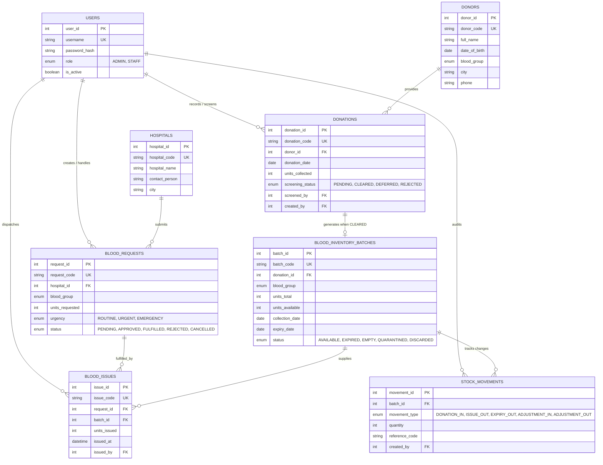

# 🩸 Blood Bank Management System (DBMS Coursework Project)

A complete, production-structured college Database Management System (DBMS) web application built using **Node.js 20+, Express, MySQL 8, HTML5, CSS3, and Vanilla JavaScript**.

> **⚠️ Academic Demonstration Notice:**
> All donor names, contact numbers, hospital requests, donation logs, and inventory batches in this repository are synthetic. This software is designed strictly for educational coursework and DBMS viva demonstrations. It does not provide medical guidance, clinical compatibility advice, or automated transfusion clearance.

---

## 📌 Project Overview & Architecture

- **Backend:** Node.js 20+ with Express.js
- **Database Engine:** MySQL 8.0+ via `mysql2/promise` with connection pooling
- **Templating Engine:** EJS (Server-rendered HTML views)
- **Security & Usability:**
  - Password Hashing: Node's native `crypto.pbkdf2Sync` (Werkzeug-compatible `pbkdf2:sha256:600000$salt$hex_digest` format with timing-safe comparison)
  - Sessions: `express-session` with MySQL store (`express-mysql-session`)
  - CSRF Protection: Session-bound cryptographic tokens on all mutating POST requests
  - Brute-Force Rate Limiting: `express-rate-limit` on login endpoint
  - HTTP Security Headers: `helmet`
- **Frontend:** Pure semantic HTML5, custom responsive CSS (light theme with navy text and crimson accents), and lightweight vanilla JavaScript for dynamic table filtering, modal confirmations, and form helpers.

---

## 🗄️ Database Tables & Schema Design

The system runs on the `blood_bank_demo` database and maintains strict referential integrity across 8 core relational tables and 1 analytical view:

| Table / View | Description | Key Relationships |
| :--- | :--- | :--- |
| `users` | System operators (Administrator & Staff) | Primary entity for auditing |
| `donors` | Registered voluntary donors | Parent to `donations` (1-to-Many) |
| `hospitals` | Partner healthcare facilities and clinics | Parent to `blood_requests` (1-to-Many) |
| `donations` | Physical whole blood collection sessions | FK to `donors`, `users`; 1-to-1 with `blood_inventory_batches` |
| `blood_inventory_batches` | Tested and cleared units in storage | FK to `donations`; Child to `blood_issues`, `stock_movements` |
| `blood_requests` | Clinical blood requisitions submitted by hospitals | FK to `hospitals`, `users`; Parent to `blood_issues` |
| `blood_issues` | Dispatched blood units fulfilling hospital requests | FK to `blood_requests`, `blood_inventory_batches`, `users` |
| `stock_movements` | Immutable audit ledger of all inventory events | FK to `blood_inventory_batches`, `users` |
| `v_current_blood_stock` | View aggregating active available units by blood group | Filtered for `AVAILABLE` status and unexpired dates |

---

## 📊 Database Relationships (Mermaid ER Diagram)



---

## 🪟 Windows Setup Guide (PowerShell from Scratch)

Follow this complete step-by-step walkthrough on a Windows laptop using **PowerShell (Run as Administrator)**.

### Step 1: Install Prerequisites via PowerShell

Open **PowerShell as Administrator** (Right-click Start menu → **Terminal (Admin)** or **Windows PowerShell (Admin)**).

Install Node.js, Git, and MySQL using Windows Package Manager (`winget`):

```powershell
# 1. Install Node.js LTS
winget install OpenJS.NodeJS.LTS -e --accept-source-agreements --accept-package-agreements

# 2. Install Git
winget install Git.Git -e --accept-source-agreements --accept-package-agreements

# 3. Install MySQL Server 8.0+
winget install Oracle.MySQL -e --accept-source-agreements --accept-package-agreements
```

> **Alternative Manual Installers (if winget is unavailable):**
> - **Node.js:** [https://nodejs.org](https://nodejs.org) (Download Windows LTS `.msi`)
> - **Git:** [https://git-scm.com](https://git-scm.com) (Download 64-bit Git for Windows)
> - **MySQL:** [https://dev.mysql.com/downloads/installer/](https://dev.mysql.com/downloads/installer/) (Download MySQL Installer, install *MySQL Server 8.0*, and set a root password during setup)

---

### Step 2: Add MySQL to PowerShell PATH (If Needed)

If PowerShell displays `'mysql' is not recognized as the name of a cmdlet`, add MySQL's `bin` folder to your Path:

```powershell
# Add MySQL to PATH for the current PowerShell session:
$env:Path += ";C:\Program Files\MySQL\MySQL Server 8.0\bin"

# (Optional) Permanently add to System Environment Variables:
[Environment]::SetEnvironmentVariable("Path", $env:Path + ";C:\Program Files\MySQL\MySQL Server 8.0\bin", [EnvironmentVariableTarget]::Machine)
```

Restart PowerShell or open a new terminal tab to verify:
```powershell
mysql --version
node -v
npm -v
```

---

### Step 3: Verify and Start the MySQL Windows Service

Ensure the MySQL background service is active in PowerShell:

```powershell
# Check service status
Get-Service MySQL80

# If Status is Stopped, start it:
Start-Service MySQL80
```
*(Or run `net start MySQL80`)*

---

### Step 4: Clone the Project from GitHub

In your PowerShell window, navigate to your desired directory (e.g. `C:\Users\<YourUser>\Documents` or `C:\Projects`) and clone the repository:

```powershell
# Clone the repository
git clone https://github.com/kanchan-nath/bloodD.git

# Enter project directory
cd bloodD
```

*(Alternatively, download the ZIP from GitHub, extract it, and `cd` into the extracted folder in PowerShell).*

---

### Step 5: Import the Database (`blood_bank_management.sql`)

> ⚠️ **Important PowerShell Note:** PowerShell does NOT support standard `<` input redirection (it throws `The '<' operator is reserved for future use`).
> Use either of the two PowerShell commands below:

```powershell
# Method A (Recommended in PowerShell):
Get-Content blood_bank_management.sql -Raw | mysql -u root -p

# Method B (Using MySQL source command):
mysql -u root -p -e "source blood_bank_management.sql"
```

Type your MySQL root password when prompted and press Enter.

To verify that the database and all 10 tables were imported successfully:
```powershell
mysql -u root -p -e "SHOW DATABASES; USE blood_bank_demo; SHOW TABLES;"
```

---

### Step 6: Create and Configure the `.env` File

Create your local `.env` configuration file from `.env.example`:

```powershell
# Copy example configuration to .env
Copy-Item .env.example .env

# Open in Notepad to edit credentials
notepad .env
```

Ensure `.env` contains your correct local credentials:
```env
PORT=3000
SESSION_SECRET=blood-bank-college-dbms-session-secret-key-2026
DB_HOST=127.0.0.1
DB_PORT=3306
DB_NAME=blood_bank_demo
DB_USER=root
DB_PASSWORD=YourMySQLRootPassword
```
*(Save and close Notepad).*

---

### Step 7: Install Node.js Dependencies

In PowerShell within the `bloodD` directory:

```powershell
npm install
```

---

### Step 8: Run Automated Test Suites

Run the built-in test runner to ensure hashing, relational integrity, queries, and connection pool are healthy:

```powershell
npm test
```
All 7 tests should report `pass 7`.

---

### Step 9: Start the Application

To start the server:

```powershell
npm start
```
*(Or run in watch mode: `npm run dev`)*

The terminal will confirm:
```text
========================================================================
🩸 BLOOD BANK MANAGEMENT SYSTEM — COLLEGE DBMS PROJECT
------------------------------------------------------------------------
🚀 Server running at: http://localhost:3000
💾 Database: blood_bank_demo @ 127.0.0.1:3306
========================================================================
[DB] Successfully connected to MySQL at 127.0.0.1:3306, Database: blood_bank_demo
```

Open your browser and navigate to: **`http://localhost:3000`**

---

### 🛠️ Windows PowerShell Troubleshooting Checklist

| Issue | Cause | PowerShell Fix |
| :--- | :--- | :--- |
| **`Execution of scripts is disabled on this system`** | PowerShell default ExecutionPolicy restricts scripts | Run: `Set-ExecutionPolicy -ExecutionPolicy RemoteSigned -Scope CurrentUser` |
| **`The '<' operator is reserved for future use`** | Tried `mysql < file.sql` in PowerShell | Use: `Get-Content blood_bank_management.sql -Raw \| mysql -u root -p` |
| **`connect ECONNREFUSED 127.0.0.1:3306`** | MySQL Windows service is stopped | Run: `Start-Service MySQL80` or `net start MySQL80` |
| **`Access denied for user 'root'@'localhost'`** | Incorrect password in `.env` | Update `DB_PASSWORD` in `.env` to match your MySQL root password |
| **`EADDRINUSE: address already in use :::3000`** | Another process is using port 3000 | Find & kill process: `Get-Process -Id (Get-NetTCPConnection -LocalPort 3000).OwningProcess \| Stop-Process -Force` |

---

## 🔑 Demo Login Credentials

| Username | Password | Role | Permissions |
| :--- | :--- | :--- | :--- |
| `admin` | `Admin@123` | **Administrator** | Full CRUD, Donor & Hospital deletions, Approval & Fulfillment |
| `staff` | `Staff@123` | **Staff Member** | Donor/Donation entry, Screening, Requisition creation & fulfillment |

> ⚠️ **Security Warning:** These demo accounts and PBKDF2 hashes are supplied exclusively for local academic evaluation. Replace passwords and session secrets prior to deploying to any shared environment.

---

## 🎓 DBMS Viva & Practical Examination Explanations

Here are the key theoretical and practical DBMS concepts demonstrated in this project:

### 1. CRUD Operations (Create, Read, Update, Delete)
- **Create:** Registering a new donor (`INSERT INTO donors ...`) or hospital (`INSERT INTO hospitals ...`).
- **Read:** Displaying paginated and searchable tables filtered by blood group and keywords (`SELECT ... WHERE blood_group = ? AND full_name LIKE ?`).
- **Update:** Modifying donor contact details or updating request statuses (`UPDATE blood_requests SET status = 'APPROVED' WHERE request_id = ?`).
- **Delete with Safety:** Destructive actions are restricted to POST requests and protected with CSRF verification.

### 2. Primary Keys & Foreign Keys (Referential Integrity)
- **Primary Keys:** Every table features a surrogate integer primary key with `AUTO_INCREMENT` (`donor_id`, `hospital_id`, `donation_id`, etc.) and a unique business code (`donor_code`, `batch_code`).
- **Foreign Key Enforcement:** Foreign keys prevent orphaned records.
  - *Viva Example:* If an administrator attempts to delete Donor #1 (`Aarav Sen`), MySQL rejects the operation because `donations` records reference `donor_id = 1`. The web app catches this and explains the relational rule to the user.

### 3. Relational JOINs
- **Multi-Table INNER JOIN:**
  Combining requests, hospitals, and blood issues to calculate total blood units received by hospital:
  ```sql
  SELECT h.hospital_name, h.city, SUM(bi.units_issued) AS total_units_received
  FROM hospitals h
  JOIN blood_requests r ON h.hospital_id = r.hospital_id
  JOIN blood_issues bi ON r.request_id = bi.request_id
  GROUP BY h.hospital_id, h.hospital_name, h.city;
  ```
- **LEFT JOIN:**
  Retaining all donations even if a screening review has not yet been assigned (`LEFT JOIN users u_screened ON d.screened_by = u_screened.user_id`).

### 4. Aggregate Functions & GROUP BY
- `COUNT(*)`: Calculates donor totals and request volumes.
- `SUM(units_available)`: Aggregates real-time inventory levels.
- `DATE_FORMAT(donation_date, '%Y-%m')`: Groups continuous dates into monthly reporting bins.

### 5. Nested Subqueries
Used on the Reports page to identify inventory batches nearing expiration:
```sql
SELECT b.batch_code, b.blood_group, b.units_available, b.expiry_date
FROM blood_inventory_batches b
WHERE b.batch_id IN (
  SELECT batch_id 
  FROM blood_inventory_batches 
  WHERE expiry_date <= DATE_ADD(CURDATE(), INTERVAL 14 DAY)
);
```

### 6. Atomic Transactions & ACID Properties
In the Stock Fulfillment workflow (`routes/requests.js` → `POST /requests/:id/issue`):
1. **Atomicity:** Decrementing inventory batches, inserting `blood_issues` records, inserting `stock_movements` (ISSUE_OUT) records, and marking `blood_requests` as `FULFILLED` are executed inside `conn.beginTransaction()`. If any step fails or stock is insufficient, `conn.rollback()` restores the exact previous state.
2. **Consistency:** Schema check constraints (`chk_batch_units`, `chk_issued_units`) ensure `units_available >= 0` at all times.
3. **Isolation:** Rows are locked using `FOR UPDATE` so concurrent requests for the same blood group cannot result in double-allocation or race conditions.
4. **Durability:** Once `conn.commit()` succeeds, the changes are permanently recorded in MySQL transaction logs.

### 7. FIFO (First-In, First-Out) Inventory Rotation
Blood products have fixed storage lifespans (35 days for whole blood). The system uses:
```sql
ORDER BY expiry_date ASC, batch_id ASC FOR UPDATE
```
This guarantees that units nearest to expiration are allocated first, minimizing waste.

---

## 📁 Repository Structure

```text
BloodD/
├── .env.example                # Template for environment configuration
├── .gitignore                  # Git exclusions (node_modules, .env, logs)
├── README.md                   # Complete viva and installation documentation
├── package.json                # Project dependencies and test scripts
├── server.js                   # Express application entry point & middleware setup
├── blood_bank_management.sql   # Complete MySQL 8 database schema and seed records
├── db/
│   └── pool.js                 # mysql2/promise connection pool configuration
├── middleware/
│   ├── auth.js                 # Authentication and role-based access control
│   └── csrf.js                 # Session-bound CSRF validation middleware
├── routes/
│   ├── auth.js                 # Login, session management, logout
│   ├── dashboard.js            # Analytical dashboard queries and metric cards
│   ├── donors.js               # Donor CRUD and donation history
│   ├── donations.js            # Collection intake & laboratory screening workflow
│   ├── hospitals.js            # Hospital partner CRUD operations
│   ├── inventory.js            # Storage batch inspection & expiry tracking
│   ├── requests.js             # Hospital requisitions & transactional stock issue
│   └── reports.js              # Comprehensive SQL analytics & viva reports
├── utils/
│   └── crypto.js               # Werkzeug-compatible PBKDF2 hash verification
├── views/
│   ├── dashboard.ejs           # Main operational dashboard
│   ├── login.ejs               # Sign-in portal with demo auto-fill
│   ├── reports.ejs             # SQL reports with collapsible syntax
│   ├── donors/                 # Donor listing, form, and profile views
│   ├── donations/              # Donation listing and collection intake form
│   ├── hospitals/              # Hospital directory and partner form
│   ├── inventory/              # Inventory batch table and audit trail view
│   ├── requests/               # Blood requests, detail, and fulfillment view
│   └── partials/               # Reusable headers, sidebar, alerts, and banners
├── public/
│   ├── css/style.css           # Clean custom stylesheet (Navy & Crimson theme)
│   └── js/main.js              # Dynamic search, dialogs, and helper scripts
├── dataset/                    # Synthetic CSV seed archives
└── tests/
    ├── crypto.test.js          # PBKDF2 verification & round-trip tests
    └── system.test.js          # DB connection, views, integrity, and FIFO tests
```
